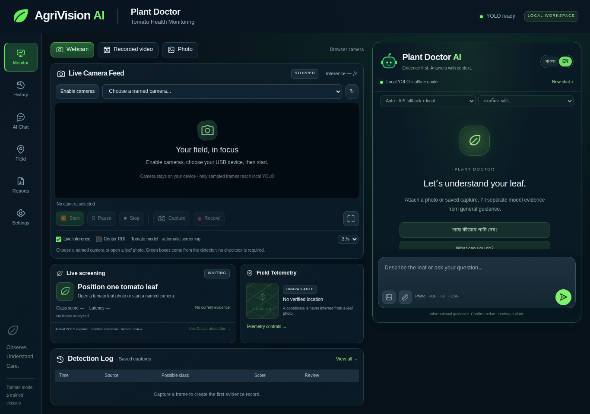

# AgriVision AI — Tomato Leaf Screening & Bilingual Plant Doctor

**AgriVision AI** is a web-based agricultural decision-support prototype for preliminary tomato-leaf health screening, transparent computer-vision results, and Bangla/English plant-care information.

> **Research/demo prototype:** Model scores do not confirm botanical diagnoses, determine disease severity, or establish field accuracy.



## Features

- **Photo & browser-camera screening:** Use a tomato-leaf image upload or a permitted browser-connected camera.
- **YOLO vision:** The default hybrid workflow combines a secondary nine-label YOLOv8n detector (real boxes) and a preserved user-trained five-class YOLO26n classifier. Disagreements and uncertainty are reported instead of hidden.
- **Plant Doctor:** Cautious Bangla/English advice grounded in curated plant-care guides, with optional configured AI providers and an offline fallback.
- **Evidence & review:** Captured images, separate raw and annotated views, recordings, screening history, and CSV export.
- **Source transparency:** Uploaded photos, live camera, recorded footage, and unavailable/simulated/device/recorded location data are distinguished.

### Supported model categories

**Original 5-class classifier:** Bacterial Spot, Early Blight, Healthy, Late Blight, Yellow Leaf Curl Virus.

**Secondary 9-label detector:** Early Blight, Septoria Leaf Spot, Healthy, Bacterial Spot, Late Blight, Tomato Mosaic Virus, Tomato Yellow Virus, Leaf Mold, Spider Mites.

These are **different** models and class vocabularies. The 26 educational Plant Doctor guide topics are **not** 26 visually trained conditions. Nutrient deficiency and other crops are not verified image-recognition classes in this release.

## Tech Stack

Python, FastAPI, Uvicorn, Ultralytics YOLO, PyTorch, OpenCV, SQLite, HTML, CSS, and vanilla JavaScript.

The static dashboard and APIs are served by **one FastAPI application**. No Next.js or Node.js build is needed to run the site.

## Local setup (Windows)

1. Install Python 3.12 (64-bit) and clone/download this repository.
2. Run `SETUP_WINDOWS.bat` from the extracted project root.
3. Run `RUN_AGRIVISION_WINDOWS.bat`.
4. Open [http://localhost:8000](http://localhost:8000).
5. Test with a tomato-leaf photo and **Offline · YOLO + guides** mode before enabling optional cloud providers.

Alternatively, after dependencies are installed, run from the root directory:

```powershell
python -m uvicorn backend.app:app --host 127.0.0.1 --port 8000
```

For exact installation, model-profile, camera and troubleshooting instructions, see [README_BN.md](README_BN.md).

## Render deployment (staging only; not production-ready)

This app was originally built for **local operation**. A cloud deployment must address authentication, public upload privacy, provider usage controls, storage durability, and memory requirements.

For a controlled FastAPI staging service:

| Render setting | Value |
| --- | --- |
| Service type | Web Service |
| Language | Python 3 |
| Root directory | Repository root (leave blank) |
| Build command | `pip install -r requirements.txt` |
| Start command | `uvicorn backend.app:app --host 0.0.0.0 --port $PORT` |
| Health check | `/api/health` |
| `PYTHON_VERSION` | `3.12.10` |
| `ALLOWED_HOSTS` | Actual Render hostname, e.g. `your-service.onrender.com` |
| `CHAT_PROVIDER_ORDER` | `offline` for a no-external-key demonstration |

**Limitations:** PyTorch/YOLO may exceed the 512 MB memory of Render's Free service. OpenCV's system dependencies can also require adjustments on some Linux build images. Free-service SQLite/media files are ephemeral, so uploaded evidence may vanish on restart or redeploy. A hosted service cannot directly access a local laptop's USB camera; browser camera streams require HTTPS, explicit browser permissions, and image frames uploaded to the server for inference.

**Security:** This repository has no public-user authentication or per-user isolation. Do not enable paid/secret AI provider keys or accept private customer uploads on a public Render service without adding authentication, rate limits, retention controls, and other protections.

## Evidence & documentation

- [Model card](MODEL_CARD.md) — class coverage, model origins, caveats and known errors
- [Data provenance](DATASET_PROVENANCE.md) — secondary-data sources and reuse disclosure
- [Architecture](ARCHITECTURE.md) — request, vision, evidence and chat workflows
- [QA report](QA_REPORT.md) — tests, issues and validation scope
- [Third-party notices](THIRD_PARTY_NOTICES.md) — source attributions and licenses
- [Judge demo (Bangla)](JUDGES_DEMO_BN.md) — three-minute live walkthrough

The original classifier was preserved without retraining in this release; the third-party nine-class detector has its own cited provenance. This repository does not claim an operational flying drone, working Raspberry Pi, field-validated accuracy, verified leaf GPS, or automated pesticide/fertilizer prescriptions.

## Responsible use

A model label is only an initial visual screening suggestion. Several diseases and non-disease conditions look alike. Consult an agricultural expert before high-consequence treatment decisions.

---

**Domain:** Agricultural AI / AgriSphere AI  
**Institution:** Daffodil International University, Bangladesh  
**Repository:** https://github.com/sadia-zannat/AgriVision-AI-2026
